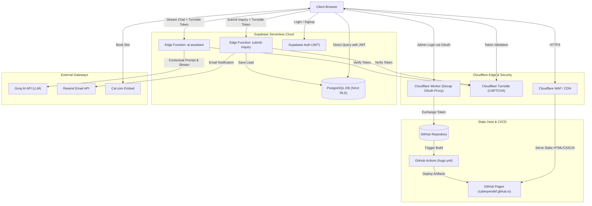

# CYBERPENDEF: SYSTEM ARCHITECTURE, TECH STACK & PROJECT STATUS

> **Context Usage:** Provide this document to AI vibe coding agents and LLMs to provide complete architectural, structural, and operational context of the CyberPenDef website codebase.

---

## 1. Executive Summary & Philosophy

* **Project Name:** CyberPenDef Website (`cyberpendef.github.io`)
* **Mission:** Professional freelance platform providing IT troubleshooting, system hardening, and offensive security/VAPT consultancy for startups, businesses, freelancers, and individuals in Kurnool, AP, India, and remotely across India and the Gulf region.
* **Core Architectural Principle:** **"Zero-Cost Hardened Hybrid (JAMstack)"**
  * **Zero Hosting Cost:** Leverages free tiers across GitHub Pages, Cloudflare, Supabase, Groq, and Resend.
  * **Zero-Trust Security-First:** No traditional web servers to patch or exploit. The attack surface is minimized by combining a static frontend with edge WAF, strict Content Security Policy (CSP), cryptographically verified Turnstile tokens, and database Row Level Security (RLS).
  * **Static Core with Serverless Dynamics:** Hugo compiles the static structure; client-side Vanilla JavaScript and Supabase Edge Functions power all dynamic features (Client Portal, AI Assistant, Form Inquiries).

---

## 2. Technology Stack Matrix

| Layer                     | Technology                       | Role & Implementation Details                                                                                         | Cost |
| :------------------------ | :------------------------------- | :-------------------------------------------------------------------------------------------------------------------- | :--- |
| **Static Site Generator** | **Hugo Extended** (v0.130+)      | Compiles templates (`layouts/`), markdown (`content/`), and styles (`assets/`) into static HTML/CSS/JS.               | $0   |
| **Hosting & CI/CD**       | **GitHub Pages + Actions**       | Automated CI workflow (`.github/workflows/hugo.yml`) builds on push to `main` and deploys to `cyberpendef.github.io`. | $0   |
| **Edge / WAF / DNS**      | **Cloudflare**                   | DNS proxy, DDoS mitigation, HTTPS enforcement, and security headers.                                                  | $0   |
| **Anti-Bot / CAPTCHA**    | **Cloudflare Turnstile**         | Non-intrusive CAPTCHA protecting inquiries, client portal signup, and AI chatbot. Dual-validated on client & edge.    | $0   |
| **Database & Auth**       | **Supabase (PostgreSQL)**        | Stores client profiles, inquiries, and service tickets. Client authentication via Supabase Auth (Email/Password).     | $0   |
| **Serverless Logic**      | **Supabase Edge Functions**      | Deno/TypeScript serverless functions (`submit-inquiry`, `ai-assistant`) handling API calls and secret keys.           | $0   |
| **AI LLM Engine**         | **Groq API** (Llama 3 / Mixtral) | High-speed LLM inference gateway for the real-time streaming chatbot.                                                 | $0   |
| **Transactional Email**   | **Resend API**                   | Automated email dispatch triggered by Edge Functions upon new inquiry submissions.                                    | $0   |
| **Git-Backed CMS**        | **Decap CMS** (Netlify CMS)      | Web-based editor at `/admin`; GitHub backend uses the Cloudflare OAuth Worker and GitHub App repository permissions. | $0   |
| **Meeting Scheduling**    | **Cal.com**                      | Embedded booking widget (`/contact` & `/services`) for 15-minute consultations without third-party redirects.         | $0   |
| **Service Reliability**   | **GitHub Actions Cron**          | `.github/workflows/supabase-keepalive.yml` pings Supabase REST API every 4 days to prevent free-tier pausing.         | $0   |

---

## 3. High-Level Architecture Diagram



---

## 4. Key Component Workflows & System Design

### 4.1. Contact & Inquiry System (`/contact`)
1. User completes form fields and resolves Cloudflare Turnstile challenge.
2. Client-side JS intercepts submission and `POST`s JSON payload + Turnstile token to Supabase Edge Function `submit-inquiry`.
3. Edge Function verifies the token against Cloudflare's `/siteverify` API using `TURNSTILE_SECRET_KEY`.
4. Upon successful validation, the lead is stored in the PostgreSQL `inquiries` table, and an email notification is dispatched via Resend.
5. Replaces legacy third-party form processors (e.g., Formspree) with an isolated, self-hosted serverless workflow.

### 4.2. Client Portal & Authenticated Dashboard (`/portal`)
1. **Separated Auth Flow:** Dedicated login (`/portal/login`) and registration (`/portal/signup`) views protected by Turnstile.
2. **Session Handling:** Authenticates via Supabase Email/Password; stores secure session token in client browser.
3. **Protected Dashboard (`/portal/dashboard`):** Client-side JS validates active session; redirects unauthenticated visitors to `/portal`.
4. **Data Retrieval:** Frontend queries `service_tickets` directly via `supabase-js`.
5. **Zero-Trust Access Control:** Supabase PostgreSQL evaluates Row Level Security (`auth.uid() = client_id`), guaranteeing clients can never read or modify tickets belonging to other users.

### 4.3. AI Assistant Chatbot (Floating Widget)
1. Injected globally across pages via `layouts/partials/chatbot.html`.
2. Users trigger chat; input is verified with Turnstile to prevent automated prompt spam.
3. Requests stream to Supabase Edge Function `ai-assistant` which holds the system prompt, guardrails, and Groq API credentials.
4. Response is streamed chunk-by-chunk using Fetch ReadableStream, providing immediate feedback without frontend token exposure.

### 4.4. Content Management System (Decap CMS at `/admin`)
1. Decap CMS single-page app loaded from `static/admin/index.html` and configured via `static/admin/config.yml`.
2. Uses the custom Cloudflare Worker (`cloudflare/decap-oauth-worker.js`) for GitHub App user authorization and the Decap popup handshake; GitHub App installation and repository permissions govern API access.
3. The CMS configuration defines these content areas:
   * **Site Pages:** Selected front matter and body fields in the Home, About, Services, and Contact page files.
   * **Service Catalog:** `data/services.yaml`, including service categories and editable service-card details.
   * **About Profile:** `data/about.yaml`, including the profile sections and their content.
   * **Homepage Content:** `data/home.yaml`, including the hero, promotion, overview, audiences, credentials, and call to action.
   * **Contact Page Content:** `data/contact.yaml`, including hero copy, inquiry-form labels/options, contact channels, business hours, and location/delivery information.
   * **Client Portal Content:** `data/portal.yaml`, including login, signup, and dashboard copy; authentication and ticket behavior remain code-managed.
   * **Blog:** Markdown files in `content/blog/`, with title, date, summary, category, tags, reading time, accent color, featured/draft flags, SEO metadata, optional featured image, and Markdown body.
   * **Portfolio:** Markdown files in `content/portfolio/`, with project summary, client/type, service category, challenge, solution, outcome, tools, metrics, featured/draft flags, optional image, and Markdown body.
4. Uses `editorial_workflow` for draft staging, review pull requests, and publication. Blog and portfolio filenames use the configured date-prefixed slug; uploaded media is stored under `static/uploads/` and published at `/uploads/`.
5. Changes committed or merged to `main` trigger the Hugo GitHub Actions deployment workflow.

### 4.5. Structured Services Catalog
1. Service descriptions and category metadata are stored in `data/services.yaml`, separate from their presentation.
2. Decap CMS edits this catalog through the `Service Catalog` collection in `static/admin/config.yml`.
3. Hugo renders each category and service through `layouts/services/list.html` and the reusable `layouts/partials/services/card.html` component.
4. Existing service illustrations are retained as individual partials in `layouts/partials/services/illustrations/`; CMS editors can assign a provided illustration or use the generic fallback for a new service.

### 4.6. Structured Homepage and About Content
1. Homepage copy and repeated cards are stored in `data/home.yaml`; `layouts/index.html` iterates through this data while retaining the existing page structure and design classes.
2. The Decap CMS `Home Page Content` collection edits the homepage hero, promotion, edge cards, overview, audiences, credentials, and closing call to action.
3. About page sections are stored in `data/about.yaml` and rendered by `layouts/about/list.html`; the shared `layouts/partials/section_header.html` keeps section headings consistent.
4. `layouts/partials/section_header.html` uses theme classes rather than dynamic inline CSS so Hugo can safely render the section colors.

### 4.7. Structured Contact Page Content
1. Contact page copy, inquiry form labels and options, contact channel cards, weekly hours, and delivery information are stored in `data/contact.yaml`.
2. The Decap CMS `Contact Page Content` collection edits these values without exposing form-submission logic or provider configuration as editable markup.
3. `layouts/contact/list.html` retains the existing inquiry form, Turnstile integration, Supabase Edge Function submission, contact links, and booking embed while rendering the editable copy from structured data.
4. Inquiry feedback writes server-returned errors as text instead of inserting them as HTML, so feedback content is not interpreted as markup.

### 4.8. Structured Client Portal Copy
1. Login, signup, and dashboard labels and messages are stored in `data/portal.yaml` and rendered by the corresponding `layouts/portal/` templates.
2. The Decap CMS `Client Portal Content` collection edits visitor-facing portal copy without making authentication or route configuration editable.
3. Supabase login/signup calls, Turnstile checks, dashboard session protection, and ticket retrieval remain code-managed; error messages are written as text rather than HTML.

---

## 5. Security Architecture & Controls

* **Strict Content Security Policy (CSP):** Implemented in `layouts/_default/baseof.html`. Strictly limits `script-src`, `connect-src`, `frame-src`, and `style-src` to verified endpoints (Cloudflare Turnstile, Supabase, Google Fonts, Cal.com, and Decap CMS). Third-party endpoints like Formspree have been eradicated.
* **Dual-Layer Anti-Abuse:** Turnstile tokens are generated in the browser and cryptographically verified on the Edge Function backend before consuming AI or email quotas.
* **Zero-Trust Database Security (RLS):**
  * `inquiries`: Anonymous `INSERT` permitted; all `SELECT`/`UPDATE`/`DELETE` denied to public and anon roles.
  * `service_tickets`: Read-only `SELECT` restricted to matching `client_id = auth.uid()`. Write operations reserved for administrator service role.
  * `testimonials`: Read allowed only for records with `approved = true`.
* **Complete Secret Isolation:** No API keys for Groq, Resend, Turnstile, or Supabase Service Role exist in client-side code or Git repositories. All secrets reside in Supabase Edge environment variables.

---

## 6. Codebase Directory Map

```
cyberpendef-site/
├── .github/workflows/          # CI/CD deployment (hugo.yml) & Supabase keep-alive cron
├── assets/css/                 # Custom styling (main.css: cyberpunk neon theme; about.css)
├── cloudflare/                 # Cloudflare Worker for Decap CMS GitHub OAuth proxy
├── config.toml                 # Root Hugo configuration (metadata, menus, public params)
├── content/                    # Markdown content files (about, services, contact, portal, blog, portfolio)
├── data/                       # Structured content for homepage, About, services, contact, and portal copy
├── layouts/                    # Custom HTML/JS templates (index.html, baseof.html, portal, partials)
│   ├── _default/               # Master baseof.html layout, list.html, single.html
│   ├── partials/               # Reusable modules: chatbot, booking, and service-card components
│   │   └── services/           # Reusable service card and retained service illustrations
│   ├── services/               # Service catalog page template
│   └── portal/                 # login.html, signup.html, dashboard.html
├── static/                     # Assets served verbatim (logo.png, profile.jpg, uploads/)
│   └── admin/                  # Decap CMS dashboard (index.html, config.yml, style.css)
├── supabase/                   # Database & backend definitions
│   ├── functions/              # Deno Edge Functions (submit-inquiry, ai-assistant)
│   └── schema.sql              # Database DDL, RLS policies, indexes
├── Project Documentation/      # Architecture overview, system design, security specs
├── Report Documentation/       # Sprint & Phase completion reports (Sprints 1 through 10)
├── USER_PROFILE_CONTEXT.md     # User persona, technical skills, and AI coding instructions
└── wrangler.toml               # Cloudflare Worker deployment configuration
```

---

## 7. Development Activity & Sprint History

* **Sprint 1: Infrastructure & Security Foundation:** Proxy routing, initial database schema, foundational RLS, and Cloudflare Turnstile anti-spam setup.
* **Sprint 2: Dynamic Contact System:** Built `submit-inquiry` Supabase Edge Function, integrated Resend for notifications, replaced legacy Formspree.
* **Sprint 3: Secure Client Portal:** Supabase authentication, split login and signup views, protected `/portal/dashboard` with dynamic ticket fetching.
* **Sprint 4: AI Chatbot Integration:** Developed `ai-assistant` Edge Function with Groq API gateway; implemented frontend streaming UI with Turnstile verification.
* **Sprint 5: CMS & Scheduling Foundation:** Initialized Decap CMS, integrated Cal.com appointment widget, deployed GitHub Actions keep-alive workflow.
* **Sprint 6: CMS OAuth & Route Hardening:** Developed Cloudflare Worker OAuth proxy for GitHub authentication; isolated admin CSP.
* **Sprint 7: Blog Architecture:** Engineered blog content model, responsive listing, and markdown post detail layouts.
* **Sprint 8: Portfolio Architecture:** Built project showcase catalog and case study layouts.
* **Sprint 9: Security & Reliability Hardening:** Audited and tightened CSP in `baseof.html`, enforced safe external link attributes (`rel="noopener noreferrer"`), enabled Decap CMS editorial workflow.
* **Sprint 10: Codebase Sanitization (Complete):** Removed obsolete theme dependencies (`themes/cyberpendef/`), removed legacy backup snapshots (`old_website_backup/`), eradicated Formspree CSP references, and updated repository ignore rules.
* **Sprint 11, Phase 11.1: Service Catalog Modularization:** Moved all 20 existing services into structured YAML data, preserved their original copy and illustrations, added a reusable card partial, and exposed the catalog through Decap CMS.
* **Sprint 11, Phase 11.2: Homepage and About Content:** Moved homepage and About page copy into structured YAML, wired the homepage and About profile to reusable Hugo rendering, exposed homepage content in Decap CMS, and refreshed the README for current content editing and development workflows.
* **Sprint 11, Phase 11.3: Contact Page Content:** Moved Contact page copy, inquiry form labels and choices, channel cards, business hours, and delivery information into structured YAML; exposed those fields in Decap CMS while retaining the existing contact integrations.
* **Sprint 11, Phase 11.4: Client Portal Copy:** Moved login, signup, and dashboard labels and messages into structured YAML; exposed portal copy through Decap CMS while keeping authentication and ticket behavior code-managed.
* **Decap CMS Configuration:** `static/admin/config.yml` is the source of truth for the GitHub backend, `editorial_workflow`, uploaded media paths, and the eight CMS content areas listed in Section 4.4. Production login depends on the Cloudflare Worker and GitHub App permissions for repository contents and pull requests.

---

## 8. Agent Coding Constraints & Instructions
* **Code Commenting Requirement:**
  * Add clear, beginner-friendly comments to code blocks and critical logic.
  * Explain **what** the code does, **why** it is designed that way, and **how** it interacts with external components.
  * Write comments so that a developer with no web development background can understand, maintain, debug, and modify the code independently.
* **Modular Code Architecture:**
  * Avoid monolithic scripts and cluttered single-file logic.
  * Enforce modular design: separate styling, layout, API communication, and state handling.
  * Make components isolated and reusable so future modifications do not break existing website functionality.
* **Security & Engineering Standards:**
  * Enforce strict web security: OWASP Top 10 mitigation, robust Content Security Policy (CSP), Row Level Security (RLS), input sanitization, least privilege and many other relevant and appropriate security standards.
